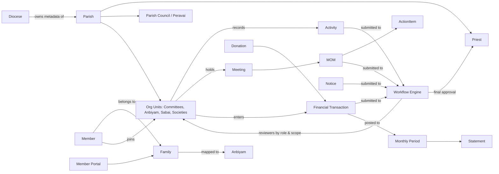
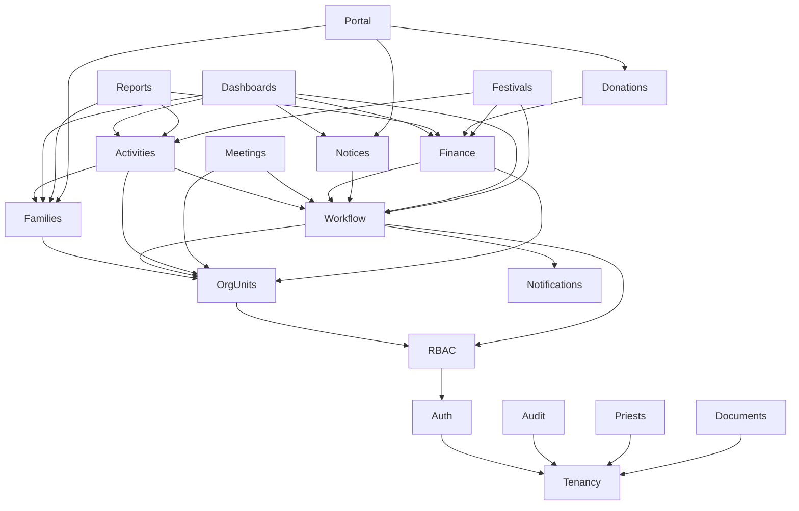

# 01 — Product Requirements (PRD / BRS / FRS summary)

## 1. Product vision

ParishSphere is a **Parish Process Management Platform** offered as multi-tenant SaaS to Catholic parishes across dioceses. It replaces paper registers, unstructured cash books and verbal approvals with:

- a single, trusted **parish register** of families, members and sacraments;
- a **configurable organisation model** (Peravai/Council, Committees, Anbiyam, Sabai, Societies, Associations);
- a common **activity / meeting / minutes / action-item** system used by every organisation unit;
- a **configurable approval engine** that routes activities, minutes, financial entries, statements and notices to the right reviewers;
- **organisation-wise accounting** with monthly statements that are reviewed, approved, released and locked;
- a **member portal** and **online donations** (phase 2);
- full **audit trail**, role-based security, and strict per-parish data isolation (database per parish).

## 2. Business domains

| Domain | Responsibility | Primary owners |
|---|---|---|
| Platform & Tenancy | Dioceses, parishes, subscriptions, tenant DB provisioning, global settings | Super Admin |
| Diocese | Diocese profile, parish mapping, aggregate reporting | Diocese Admin |
| Parish Administration | Parish profile, priests & assignment history, settings, financial year | Parish Admin, Priest |
| People | Families, members, sacramental summary, transfers, history | Secretary, Anbiyam leaders |
| Organisation | Org unit types & units, positions, office bearers, memberships | Parish Admin |
| Activities & Meetings | Activities, meetings, agenda, attendance, MOM, resolutions, action items | Every org unit |
| Workflow | Definitions, stages, instances, tasks, history, delegation, escalation | Parish Admin (configures), everyone (acts) |
| Finance | Accounts, categories, transactions, periods, statements, budgets | Treasurers, Priest |
| Content & Communication | Notices, news, notifications, templates | Secretary, Priest |
| Documents | Uploads, versions, links, historical digitisation | All (permission-based) |
| Registers | Marriage, baptism, communion, confirmation, configurable registers | Priest, Secretary |
| Portal & Donations | Family login, profile, correction requests, donations, receipts | Families, donors |
| Audit & Reporting | Audit log, reports, exports | Admins, Priest |

## 3. How parish organisations interact



Key interaction rules:
1. Every family belongs to exactly **one Anbiyam** at a time (history retained).
2. A member may belong to many Sabai/Societies subject to the org unit type's **membership rules** (age range, gender, max memberships, family vs. individual).
3. Office bearers (President/Secretary/Treasurer/Leader) are **positions within an org unit**; holding a position grants a **scoped role** used by the workflow engine to find reviewers.
4. Final authority in the parish is the **Parish Priest**; councils/committees review.
5. All money flows through **one ledger** (`fin_transactions`) tagged with the org unit — donation receipts, Anbiyam contributions and society expenses are not separate silos.

## 4. Module hierarchy

```
ParishSphere
├── Platform (Super Admin)
│   ├── Dioceses
│   ├── Parishes & Provisioning
│   ├── Plans & Subscriptions
│   └── Global Settings / Platform Audit
├── Diocese Console (Diocese Admin) — aggregates only
└── Parish Workspace (per tenant)
    ├── Dashboard (role-based)
    ├── People: Families · Members · Registers (Marriage/Sacraments/Custom)
    ├── Organisations: Council · Committees · Anbiyam · Sabai · Societies · Associations
    ├── Activities & Meetings: Activities · Meetings · MOM · Action Items · Calendar
    ├── Approvals: My Inbox · Workflow History
    ├── Finance: Transactions · Accounts · Categories · Periods & Statements · Budgets
    ├── Festivals & Events (phase 2)
    ├── Content: Notices & News
    ├── Documents (phase 2 full DMS)
    ├── Reports & Exports
    └── Administration: Users · Roles · Workflows · Org Unit Types · Master Data · Settings · Audit Log
Member Portal (phase 2): Home · Family · Notices · Events · Donate · Donation History · Requests
```

### Module dependencies



### Common reusable features (built once, used everywhere)

- Workflow engine + approval timeline UI
- Activity/meeting/MOM/action-item engine (per org unit)
- Audit logger
- Document attachment service (polymorphic links)
- Notification service (in-app + email; SMS/WhatsApp later)
- Code generator / sequences (FAM000123, TXN-2026-000045)
- Search/filter/pagination/export helpers + `DataTable` UI
- Custom fields & configurable register templates (phase 2)
- i18n (English, Tamil)

## 5. User roles & permission matrix

Permissions are `module.action`. Actions: `view, create, update, delete, submit, review, approve, reject, publish, export`. Roles are **assigned with a scope** (parish-wide, or a specific org unit). A user may hold many roles.

| Role | Scope | Key permissions (summary) |
|---|---|---|
| Super Administrator | Platform | Everything on platform; no parish data access unless explicitly impersonating (audited) |
| Diocese Administrator | Diocese | View diocese/parish metadata, aggregate stats, subscription status |
| Parish Administrator | Parish | Users, roles, workflows, org unit types, settings, master data; view all non-sensitive |
| Parish Priest | Parish | View all incl. sensitive; final approve on all workflows; release statements |
| Parish President | Parish | Review council/committee items; view activities/meetings; view finance summaries |
| Parish Secretary | Parish | Families/members CRUD; registers; notices create/review; meetings; review activities |
| Parish Treasurer | Parish | Finance CRUD/review; periods; statements prepare; export finance |
| Committee President | Org unit | Review activities/minutes of own unit |
| Committee Secretary | Org unit | Create activities/meetings/minutes of own unit; submit |
| Committee Treasurer | Org unit | Create/submit transactions of own unit |
| Anbiyam Leader | Org unit (Anbiyam) | View/update families in own Anbiyam; activities/meetings of own Anbiyam |
| Sabai Leader | Org unit (Sabai) | Activities/meetings/members of own Sabai |
| Society Leader | Org unit (Society) | Activities/meetings/members of own society |
| Reviewer | Configurable | `*.review` on assigned modules |
| Approver | Configurable | `*.approve` on assigned modules |
| General Member | Parish | View notices, own profile |
| Family Account User | Own family | Portal only: own family, notices, donations, correction requests |

Sensitive data gates: `member.view_sensitive` (DOB, contact, sacraments), `sacrament.view`, `finance.view` (detail) vs `finance.view_summary`.

## 6. Functional requirements — MVP (Core)

| Module | MVP scope |
|---|---|
| Auth | Login (subdomain or parish code), refresh rotation, logout, 30-min idle timeout with warning, lockout, password reset |
| Tenancy | Diocese/parish registration, automatic DB provisioning, migrations across tenants, tenant settings |
| RBAC | 17 seeded roles, configurable permissions, scoped assignments |
| Org units | Configurable types; Council, Committees, Anbiyam, Sabai, Societies as data; positions; office bearers; memberships |
| Families/Members | Registration (stepper), Anbiyam mapping, head of family, transfers (Anbiyam/family), merge, split, deceased, inactive, history, duplicate detection, search |
| Priests | Profile, assignment history, current priest |
| Activities & Meetings | Activities with participants/plan/actual/finance; meetings with agenda, attendance, MOM, discussion points, resolutions, action items with status tracking |
| Workflow | Definitions, stages (sequential/parallel/optional), role@scope or user assignees, reject/rework/resubmit, delegation, SLA escalation, full history |
| Finance | Accounts (cash/bank/digital), categories, transactions with workflow, balances, monthly periods, statements (PDF/XLSX, snapshot, locking, revisions via adjustments) |
| Notices | Create → review → approve → publish, audience, important flag, expiry |
| Notifications | In-app + email |
| Dashboards | Priest, President/Secretary, Treasurer, Member preview |
| Search/Reports | Global search, family/member registers, activity summary, monthly I&E, pending approvals; CSV/XLSX/PDF export |
| Audit | All listed events; searchable viewer |

## 7. Feature classification

| Feature | Class |
|---|---|
| Master data management, configurable FY, Tamil + English, audit, data validation & duplicate detection, system configuration, subscription/licensing | **Core** |
| Custom fields, custom register templates, reusable workflow templates, document templates, Excel import & bulk registration, event registration, attendance management, emergency contacts, tenant backup/restore tooling, health monitoring | **Recommended enhancement** (phase 2) |
| QR family identification, calendar integration (iCal/Google), inter-parish member transfer, digital acknowledgement, OCR, WhatsApp, additional languages | **Future enhancement** |

## 8. Missing requirements, risks and scenarios identified

1. **Restricted / designated funds** – building fund or festival collections often must not be spent elsewhere. Proposed: category-level `restricted` flag and fund balances.
2. **Cash handling** – Sunday collection counting by two counters, deposit to bank. Proposed: "collection batch" entry with two counter sign-offs (phase 2).
3. **Inter-account transfers** (cash → bank deposit) are neither income nor expense. Included as transaction type `TRANSFER`.
4. **Opening balances** at go-live per account. Included.
5. **Statement corrections after release** – handled by adjustment entries in an open period + statement revision; released versions are immutable.
6. **Privacy (India DPDP Act 2023)** – consent capture for members, data-subject access/correction (portal correction requests), retention policy. Needs legal confirmation.
7. **Minors' data** – children's sacramental info visible only to authorised roles.
8. **Mixed-parish marriages** – one spouse from another parish; marriage register must allow external party details.
9. **Families with no Anbiyam yet** (new arrivals) – allow status `PENDING_ANBIYAM` until mapped.
10. **Priest transitions** – pending approvals assigned to the outgoing priest must be re-assigned automatically on new assignment (handled by role-based resolution at action time + reassign job).
11. **Committee term changes** – office bearers change yearly; workflow assignees resolve at task-creation time; history is preserved.
12. **Offline/low-connectivity** usage in rural parishes – PWA caching is a future option.
13. **Data migration** from existing Excel registers – Excel import tool (phase 2) is a go-live dependency for most parishes.
14. **Tamil data entry** – names often stored in both scripts; members have `name` and optional `name_local`.

## 9. Open questions requiring the client's decision

| # | Question | Default used until answered |
|---|---|---|
| Q1 | Financial year start? | April–March, configurable per parish |
| Q2 | Do we need restricted funds accounting? | Category `restricted` flag, separate balance |
| Q3 | 80G/tax-exemption receipts for donations? | Phase 2; receipt template configurable |
| Q4 | Family portal login: PIN, password or OTP? SMS provider? | Family ID + password; OTP pluggable (phase 2) |
| Q5 | What may diocese users see? | Aggregated statistics only, never records |
| Q6 | Who may view sacramental records? | Priest, Parish Secretary, holders of `sacrament.view` |
| Q7 | Retention for deceased/transferred members? | Retained indefinitely, hidden from active lists |
| Q8 | Hosting model (central cloud vs. diocese on-prem) and data residency? | Central cloud in India region |
| Q9 | Amount thresholds for extra finance approval stages? | Configurable; seeded example ₹50,000 |
| Q10 | Can a member belong to multiple Sabai? | Configurable per org unit type (default: unlimited) |
