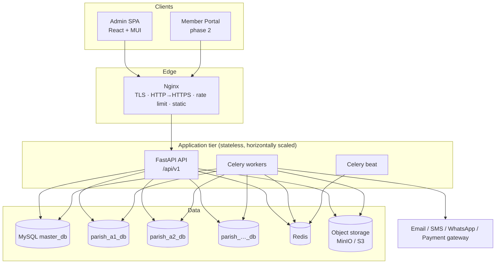
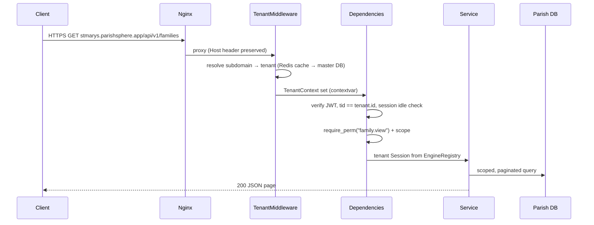

# 02 — Solution Architecture

## 1. System context



## 2. Technology decisions

| Concern | Choice | Rationale |
|---|---|---|
| API framework | **FastAPI** | Type-driven validation (Pydantic v2), automatic OpenAPI, dependency injection fits tenant/session/permission resolution |
| ORM | **SQLAlchemy 2.0 (sync) + PyMySQL** | Same service code reused by Celery workers; FastAPI runs sync endpoints in a threadpool; avoids dual async/sync stacks |
| Migrations | **Alembic**, two environments (`master`, `tenant`) | Tenant env is applied to every parish DB by the `ps-admin migrate-tenants` command |
| Background jobs | **Celery + Redis** | Notifications, PDF/XLSX generation, SLA escalation, stats snapshots, backups |
| Cache / rate limit | **Redis** | Tenant lookup cache, dashboard cache, login lockout counters |
| Files | **S3-compatible object storage (MinIO in dev)** | Per-tenant key prefix, presigned downloads, versioning |
| PDF / Excel | WeasyPrint (HTML→PDF), openpyxl | Templated, i18n-friendly (Tamil fonts) |
| Password hashing | Argon2id (`argon2-cffi`) | Current OWASP recommendation |
| Frontend | React 18 + TypeScript + Vite + **MUI 6** + MUI X DataGrid + TanStack Query + React Router 6 + React Hook Form + Zod + react-i18next + Recharts | Mature enterprise component set; strongly-typed forms |
| Logging | structlog JSON logs with `trace_id`, `tenant`, `user` | Ready for Loki/ELK |
| Monitoring | `/health/live`, `/health/ready`, Prometheus metrics (phase 2), Sentry-compatible error hook | |

## 3. Backend architecture

```
backend/
  app/
    main.py                 # app factory, middleware, routers
    core/                   # config, logging, security (hashing, jwt), errors, ids, context
    db/                     # master & tenant bases, EngineRegistry, session deps
    master/                 # master-DB models + services (dioceses, parishes, tenant DBs, platform users)
    tenancy/                # middleware, resolver, provisioning, migration runner
    common/                 # pagination, filters, audit, sequences, soft-delete, exports, storage
    modules/
      auth/  users/  rbac/  org_units/  families/  priests/  workflow/
      activities/  meetings/  finance/  notices/  notifications/  dashboard/  reports/
        models.py  schemas.py  repository.py  service.py  router.py  permissions.py
  migrations/master/  migrations/tenant/
  cli.py                     # ps-admin
  tests/
```

**Layering rules**

1. `router` – HTTP only: parse, call `require_perm`, call service, map to schema. No business logic.
2. `service` – business rules, transactions, workflow submission, audit writes, notifications.
3. `repository` – queries (filters, pagination, scope restriction). No HTTP concepts.
4. `models` – SQLAlchemy declarative models; tenant models on `TenantBase`, master on `MasterBase`.
5. Cross-module calls go through services, never repositories of other modules.

**Request lifecycle**



## 4. Frontend architecture

```
frontend/src/
  app/            # providers (Theme, Query, Router, i18n, Auth), routes
  design-system/  # theme tokens, StatCard, StatusBadge, PageHeader, DataTable, ApprovalTimeline, ...
  layouts/        # AdminLayout (sidebar + topbar), PortalLayout, AuthLayout
  auth/           # session store, idle timer, guards, login page
  api/            # axios client w/ interceptors (refresh, tenant header, error mapping), generated types
  features/<module>/  # pages, components, hooks (useFamilies, useCreateFamily …)
  i18n/           # en.json, ta.json
  lib/            # formatters (currency, dates), utils
```

- Business rules live in the backend; UI holds view logic only.
- Server state via TanStack Query hooks per feature; mutations invalidate keys.
- Permissions returned from `/auth/me` drive navigation and button visibility (UX only — backend enforces).
- Code-split per feature route.

## 5. Background processing

| Queue | Jobs |
|---|---|
| `notifications` | email send, in-app fan-out, SMS/WhatsApp (later) |
| `documents` | statement PDF/XLSX rendering, exports, thumbnailing, OCR (future) |
| `workflow` | SLA check every 15 min, escalation, reminders |
| `maintenance` | nightly parish stats snapshot → master, backups, token cleanup |

Every task receives `tenant_code` explicitly and opens its own tenant session — never relies on request context.

## 6. Document storage

- Key layout: `{tenant_code}/{category}/{yyyy}/{mm}/{ulid}.{ext}`; original filename only in metadata.
- Versions are new objects; `document_versions` keeps sha256, size, mime, uploader.
- Downloads via short-lived (5 min) presigned URLs issued after authorization; download events audited.
- Historical digitisation: metadata (register number, document date, register type), links to families/members/org units, OCR text column with FULLTEXT index (future).

## 7. Notification architecture

`NotificationService.emit(event_code, recipients, context)` → resolves template (tenant override → default, per language) → writes in-app `notifications` rows → enqueues channel deliveries per user preference → `outbound_messages` tracks status/retries.
