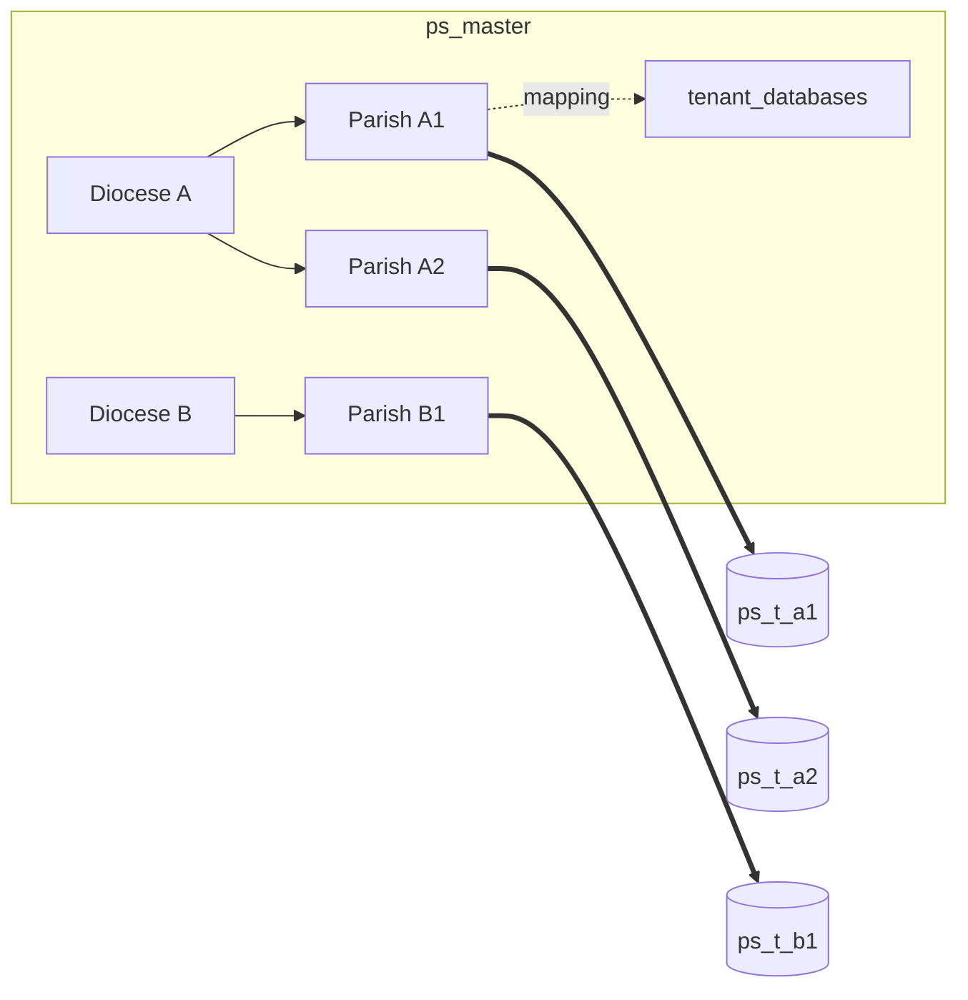
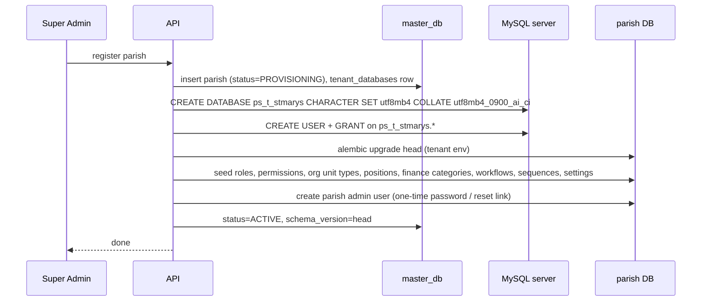

# 03 — Multi-Tenant Architecture (Database per Parish)

## 1. Model

- **One codebase, one deployment**, many tenants.
- **Master DB (`ps_master`)** holds the directory: dioceses, parishes, tenant DB mapping, subscriptions, tenant settings, platform users, aggregated stats, platform audit.
- **One MySQL database per parish** (`ps_t_<parishcode>`), each with an identical schema managed by the tenant Alembic environment.
- Dioceses never get a database of their own for parish data; they see **aggregates** pushed into master.



## 2. Tenant resolution

Order of precedence (first match wins):

1. **Subdomain**: `Host: stmarys.parishsphere.app` → `subdomain = stmarys`. The base domain is configured (`PS_BASE_DOMAIN`). `www`, `app`, `admin`, `api` are reserved.
2. **Header** `X-Parish-Code: STMARYS` — used by the login page when served from the shared domain or `localhost` in development.
3. Requests to `/api/v1/platform/*` are **platform-scoped** (no tenant) and require a platform user token.

Resolution steps (`TenantMiddleware`):

```
code ← subdomain or header
tenant ← Redis GET tenant:{code}  (TTL 300s)  || master lookup → cache
if not tenant → 404 TENANT_NOT_FOUND
if tenant.status ∉ {ACTIVE, TRIAL} → 403 TENANT_SUSPENDED
TenantContext.set(tenant)   # contextvar, reset after response
```

**Token binding.** Access tokens carry `tid` (tenant ULID) and `typ` (`tenant` or `platform`). `get_current_user` rejects a token whose `tid` differs from the resolved tenant with 403 `TENANT_MISMATCH`. Thus a valid token from Parish A presented to Parish B's host is useless. Tenant is **never** read from the request body or query string.

## 3. Connection lifecycle & pooling

```python
class EngineRegistry:
    # LRU of tenant_code → Engine, capped (PS_TENANT_ENGINE_CACHE, default 200)
    def get(tenant) -> Engine:
        engine = cache.get(tenant.code)
        if engine is None:
            url = build_url(tenant.db_host, tenant.db_name, decrypt(tenant.db_user_secret))
            engine = create_engine(url, pool_size=5, max_overflow=5,
                                   pool_pre_ping=True, pool_recycle=1800)
            cache.put(tenant.code, engine)   # evicted engines are .dispose()d
        return engine
```

- Each request obtains a `Session` bound to the tenant engine via the `get_tenant_session` dependency; commit on success, rollback on exception, always closed.
- Worst-case connections per app replica = `hot_engines × (pool_size + overflow)`; with 200 × 10 this is too many for one MySQL host, so in production:
  - keep `pool_size` small (2–5) and rely on LRU eviction for idle tenants;
  - place **ProxySQL** in front of MySQL for connection multiplexing at scale;
  - distribute tenants over multiple MySQL hosts (`tenant_databases.db_host`) — sharding without code changes.
- Celery workers use the same registry.

## 4. Isolation & security

| Layer | Control |
|---|---|
| Network | DB hosts reachable only from app subnet |
| Credentials | Each tenant DB has its **own MySQL user** with grants only on `ps_t_<code>.*`; password stored encrypted (Fernet, key from env/secret manager) in master |
| Application | Tenant resolved server-side; token `tid` binding; no cross-tenant joins exist in code |
| Audit | `audit_logs` writes only; app user lacks `UPDATE/DELETE` on that table in production |
| Testing | Automated tests assert cross-tenant token/ID access fails |
| Backups | Per-tenant dumps, encrypted at rest |

In development/test a single privileged user may be used for convenience (`PS_TENANT_DB_SHARED_CREDENTIALS=true`).

## 5. Provisioning

`ps-admin provision-parish --code STMARYS --name "St. Mary's Church" --diocese CHN --subdomain stmarys --admin-email ... ` (also `POST /api/v1/platform/parishes`, executed as a background job):



Provisioning is idempotent: every step checks for existing state, so a failed run can be re-executed.

## 6. Migrations across tenants

- `migrations/master` — master schema.
- `migrations/tenant` — parish schema; `env.py` reads `-x tenant=<code>` (or a URL) and runs against that DB.
- `ps-admin migrate-tenants [--only CODE] [--parallel N] [--dry-run]`:
  1. lists tenants from master (status ≠ ARCHIVED),
  2. runs `upgrade head` per tenant (bounded parallelism),
  3. writes `schema_version`, `migrated_at` and errors to `tenant_databases`,
  4. reports a summary; failed tenants are retried individually.
- Migrations must be **backward compatible** (expand → deploy → contract) so app replicas can run while tenants are migrated in batches.

## 7. Diocese ↔ parishes

- `parishes.diocese_id` links each parish to a diocese in master.
- Diocese admins (`platform_users` with `diocese_user_scopes`) can view their parishes' metadata, subscription status and `parish_stats_snapshots` (families, members, activities, income/expense totals per month), refreshed nightly by a Celery job that reads each parish DB with the platform's maintenance credentials and writes only aggregates.
- No API exposes parish records to diocese users.

## 8. Tenant-specific configuration

Stored in master `tenant_settings` (needed before DB connection: branding, language, status) and in parish `settings` table (financial year, currency, approval/notification configs, templates). Branding (logo, colours, name) is served by public `GET /api/v1/tenant/branding` so the login page can theme itself from the subdomain.

## 9. Backup & recovery

| Item | Strategy |
|---|---|
| Per-tenant logical backup | Nightly `mysqldump --single-transaction` per DB → gzip → encrypt (age) → object storage `backups/{code}/{date}.sql.gz.age`; retention 7 daily / 4 weekly / 12 monthly |
| Point-in-time | MySQL binlogs shipped hourly; PITR per server |
| Master DB | Same, plus more frequent (hourly) |
| Documents | Object storage versioning + cross-region replication |
| Restore | `ps-admin restore-tenant --code X --backup <key> [--target-db new]` → restore into new DB → validate → switch `tenant_databases.db_name` → audit |
| Testing | Monthly automated restore drill for a random tenant |

## 10. Scalability to thousands of parishes

- Stateless API replicas behind Nginx/LB; sticky sessions not needed.
- MySQL: several hosts, each hosting hundreds of small parish DBs; ProxySQL for pooling; tenant placement recorded in master.
- Redis caching of tenant lookups and dashboards.
- Migrations parallelised and batched.
- Large parishes can be moved to dedicated hosts by updating `db_host` after a dump/restore.
