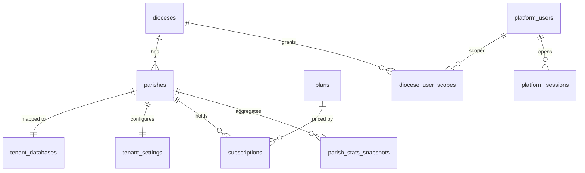
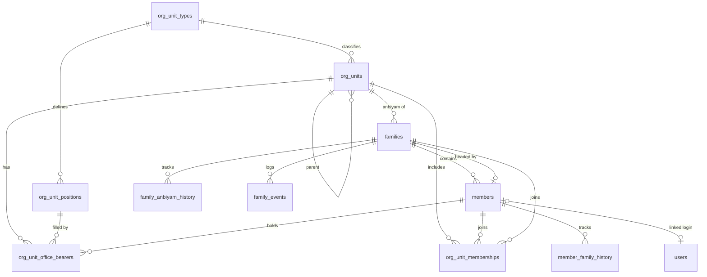
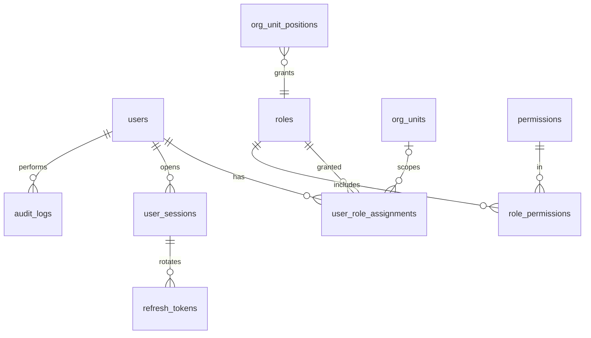
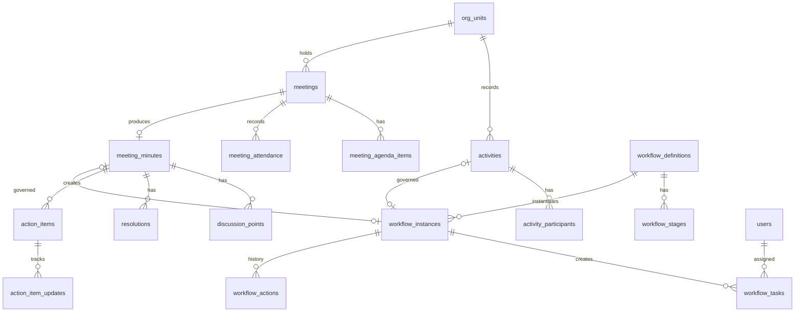
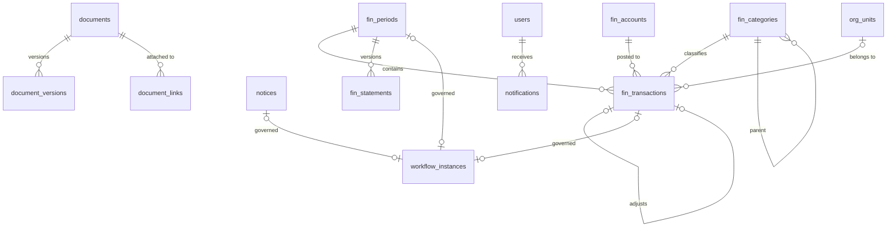

# 04 — Database Design

## 1. Conventions

| Rule | Detail |
|---|---|
| Engine / charset | InnoDB, `utf8mb4`, `utf8mb4_0900_ai_ci` (Tamil-safe) |
| Primary key | `id BIGINT UNSIGNED AUTO_INCREMENT` (internal only) |
| Public identifier | `public_id CHAR(26)` ULID, `UNIQUE`; the only ID in URLs/APIs |
| Business codes | e.g. `families.code = FAM000123`, generated from `sequences` |
| Timestamps | `created_at`, `updated_at` (`DATETIME(6)`, UTC); `created_by`, `updated_by` (user id, nullable) |
| Soft delete | `is_deleted BOOL DEFAULT 0`, `deleted_at`, `deleted_by` on business tables |
| Money | `DECIMAL(14,2)`; currency at tenant level |
| Enums | `VARCHAR(32)` + application-level enum (avoids `ALTER TABLE` for new values) |
| Flexible config | `JSON` columns for workflow conditions, custom fields, settings |
| Names | snake_case plural table names; FK `<entity>_id`; index `ix_<table>_<cols>`; unique `uq_<table>_<cols>` |
| History | effective-dated rows (`valid_from`, `valid_to`) for memberships, assignments, office bearers |

Abbreviations below: **PK** primary key, **FK** foreign key, **UQ** unique, **IX** index, **N** nullable. Audit columns (`created_at/by, updated_at/by`) and soft-delete columns are implied where marked *(std)*.

---

## 2. Master database (`ps_master`)

### dioceses *(std)*
| Column | Type | Notes |
|---|---|---|
| id | BIGINT | PK |
| public_id | CHAR(26) | UQ |
| code | VARCHAR(20) | UQ |
| name | VARCHAR(200) | |
| bishop_name | VARCHAR(200) | N |
| address, city, state, country, postal_code | VARCHAR | N |
| phone, email, website | VARCHAR | N |
| status | VARCHAR(20) | ACTIVE / INACTIVE; IX |

### parishes *(std)*
| Column | Type | Notes |
|---|---|---|
| id | BIGINT | PK |
| public_id | CHAR(26) | UQ |
| diocese_id | BIGINT | FK → dioceses; IX |
| code | VARCHAR(20) | UQ (uppercase) |
| subdomain | VARCHAR(63) | UQ (lowercase) |
| name | VARCHAR(200) | |
| status | VARCHAR(20) | PROVISIONING / TRIAL / ACTIVE / SUSPENDED / ARCHIVED; IX |
| established_on | DATE | N |
| address, city, state, country, postal_code, phone, email | VARCHAR | N |

### tenant_databases
| Column | Type | Notes |
|---|---|---|
| id | BIGINT | PK |
| parish_id | BIGINT | FK → parishes; UQ |
| db_host | VARCHAR(255) | |
| db_port | INT | |
| db_name | VARCHAR(64) | UQ |
| db_user | VARCHAR(64) | |
| db_password_enc | VARBINARY(512) | Fernet-encrypted; N (shared creds in dev) |
| schema_version | VARCHAR(64) | N |
| last_migrated_at | DATETIME | N |
| last_error | TEXT | N |

### tenant_settings
| Column | Type | Notes |
|---|---|---|
| parish_id | BIGINT | PK, FK → parishes |
| display_name | VARCHAR(200) | |
| logo_url | VARCHAR(500) | N |
| primary_color | VARCHAR(9) | N |
| default_language | VARCHAR(5) | `en` / `ta` |
| currency | CHAR(3) | `INR` |
| timezone | VARCHAR(64) | `Asia/Kolkata` |
| fy_start_month | TINYINT | 4 = April |

### plans, subscriptions
`plans(id, code UQ, name, max_families N, max_users N, features JSON, price DECIMAL, is_active)`
`subscriptions(id, parish_id FK IX, plan_id FK, status, starts_on, ends_on N, trial_ends_on N, notes)` — IX (parish_id, status).

### platform_users *(std)*
`id, public_id UQ, email UQ, full_name, password_hash, is_active, is_super_admin, last_login_at N, failed_login_count, locked_until N`.

### diocese_user_scopes
`id, platform_user_id FK, diocese_id FK` — UQ(platform_user_id, diocese_id).

### platform_sessions
`id, public_id UQ, platform_user_id FK, refresh_token_hash UQ, family_id, issued_at, expires_at, last_activity_at, revoked_at N, ip, user_agent`.

### parish_stats_snapshots
`id, parish_id FK, snapshot_date, families INT, members INT, active_org_units INT, activities_month INT, income_month DECIMAL, expense_month DECIMAL, data JSON` — UQ(parish_id, snapshot_date).

### platform_audit_logs
`id, occurred_at IX, actor_id N, action IX, entity_type, entity_id, parish_id N IX, ip, old_values JSON, new_values JSON, remarks`.

### global_settings
`key VARCHAR(100) PK, value JSON, updated_at`.

---

## 3. Parish database (`ps_t_<code>`)

### 3.1 Identity, RBAC, sessions

| Table | Key columns |
|---|---|
| **users** *(std)* | public_id UQ, username UQ, email UQ N, full_name, phone N, password_hash, member_id FK→members N, is_active, must_change_password, last_login_at N, failed_login_count, locked_until N, preferred_language |
| **roles** *(std)* | public_id UQ, code UQ, name, description N, is_system (seeded, not deletable), scope_type (`PARISH` / `ORG_UNIT` / `FAMILY`) |
| **permissions** | id, code UQ (`family.view`), module IX, action, description |
| **role_permissions** | role_id FK, permission_id FK — PK(role_id, permission_id) |
| **user_role_assignments** | public_id UQ, user_id FK IX, role_id FK, org_unit_id FK N (null = parish-wide), valid_from, valid_to N, assigned_by — IX(user_id, role_id, org_unit_id) |
| **user_sessions** | public_id UQ (`sid` claim), user_id FK IX, issued_at, last_activity_at, expires_at, revoked_at N, revoke_reason N, ip, user_agent |
| **refresh_tokens** | id, session_id FK IX, token_hash UQ, issued_at, expires_at, used_at N, revoked_at N |
| **password_reset_tokens** | id, user_id FK, token_hash UQ, expires_at, used_at N |

### 3.2 Settings, sequences, audit

| Table | Key columns |
|---|---|
| **settings** | key PK, value JSON, updated_at, updated_by |
| **sequences** | name PK (`FAMILY`, `MEMBER`, `TXN-2026`), prefix, next_value BIGINT, padding — row-locked `SELECT … FOR UPDATE` |
| **audit_logs** | id, occurred_at IX, user_id N IX, action IX (`CREATE`/`UPDATE`/`DELETE`/`LOGIN`/`APPROVE`…), module IX, entity_type, entity_id (public_id) IX, ip N, user_agent N, old_values JSON N, new_values JSON N, remarks N — append-only |

### 3.3 Organisation (configurable)

| Table | Key columns |
|---|---|
| **org_unit_types** *(std)* | public_id UQ, code UQ (`COUNCIL`, `COMMITTEE`, `ANBIYAM`, `SABAI`, `SOCIETY`, `ASSOCIATION`), name, name_local N, member_kind (`MEMBER` / `FAMILY`), membership_rules JSON (min_age, max_age, gender, max_per_member), is_system, sort_order |
| **org_unit_positions** | public_id UQ, org_unit_type_id FK, code (`PRESIDENT`), name, role_id FK→roles (role granted to holder, scoped to the unit), max_holders N, sort_order — UQ(org_unit_type_id, code) |
| **org_units** *(std)* | public_id UQ, type_id FK IX, parent_id FK self N, code UQ, name, name_local N, description N, status, established_on N, meeting_place N |
| **org_unit_office_bearers** | public_id UQ, org_unit_id FK IX, position_id FK, member_id FK, user_id FK N, valid_from, valid_to N, remarks |
| **org_unit_memberships** | public_id UQ, org_unit_id FK IX, member_id FK N IX, family_id FK N IX, joined_on, left_on N, status, remarks — CHECK exactly one of member_id/family_id |

### 3.4 Families & members

| Table | Key columns |
|---|---|
| **families** *(std)* | public_id UQ, code UQ (`FAM000123`), family_name, family_name_local N, head_member_id FK N, anbiyam_id FK→org_units N IX, address_line1, address_line2 N, city N, postal_code N, phone N IX, email N, registered_on, status IX (`ACTIVE`, `PENDING_ANBIYAM`, `INACTIVE`, `TRANSFERRED_OUT`, `MERGED`), previous_parish N, previous_diocese N, remarks N, portal_enabled, portal_password_hash N |
| **members** *(std)* | public_id UQ, code UQ (`MEM000456`), family_id FK IX, first_name, last_name N, name_local N, gender, date_of_birth N, relationship_to_head, phone N IX, email N, education N, occupation N, marital_status N, status IX (`ACTIVE`, `INACTIVE`, `DECEASED`, `TRANSFERRED_OUT`, `MOVED_FAMILY`), date_of_death N, baptism_date N, baptism_place N, baptism_register_ref N, communion_date N, communion_place N, confirmation_date N, confirmation_place N, marriage_date N, marriage_place N, remarks N, search_name (normalized, IX for duplicate detection) |
| **family_anbiyam_history** | family_id FK, anbiyam_id FK, valid_from, valid_to N, changed_by, reason |
| **member_family_history** | member_id FK, family_id FK, relationship, valid_from, valid_to N, reason (`REGISTERED`, `TRANSFER`, `SPLIT`, `MERGE`) |
| **family_events** | family_id FK, event_type (`MERGE`, `SPLIT`, `TRANSFER_OUT`, `TRANSFER_IN`), related_family_id N, occurred_on, details JSON, performed_by |

FULLTEXT(`members.first_name, last_name, name_local`) and (`families.family_name`) for search.

### 3.5 Clergy & parish profile

| Table | Key columns |
|---|---|
| **parish_profile** | id=1, name, code, diocese_name, address…, phone, email, logo_key N, established_on N, patron_saint N, fy_start_month, currency, extra JSON |
| **priests** *(std)* | public_id UQ, full_name, title (Rev. Fr.), ordination_date N, phone N, email N, home_diocese N, congregation N, status, photo_key N, remarks |
| **priest_assignments** | public_id UQ, priest_id FK, role (`PARISH_PRIEST`, `ASSISTANT`, `RESIDENT`), appointed_on, relieved_on N, responsibilities N, user_id FK N — IX(role, relieved_on) |

### 3.6 Activities & meetings

| Table | Key columns |
|---|---|
| **activities** *(std)* | public_id UQ, code UQ (`ACT-2026-0001`), org_unit_id FK IX, title, description, activity_date IX, end_date N, location N, responsible_member_id FK N, planned_details N, actual_details N, planned_amount DECIMAL N, actual_amount DECIMAL N, status IX (`DRAFT`, `SUBMITTED`, `IN_REVIEW`, `REWORK`, `APPROVED`, `REJECTED`, `COMPLETED`), workflow_instance_id FK N, remarks |
| **activity_participants** | activity_id FK, member_id FK N, external_name N, role N |
| **meetings** *(std)* | public_id UQ, code UQ, org_unit_id FK IX, title, scheduled_at IX, location N, status (`SCHEDULED`, `HELD`, `CANCELLED`), called_by FK N |
| **meeting_agenda_items** | meeting_id FK, seq, title, description N, presenter_member_id N |
| **meeting_attendance** | meeting_id FK, member_id FK, status (`PRESENT`, `ABSENT`, `EXCUSED`) — UQ(meeting_id, member_id) |
| **meeting_minutes** *(std)* | public_id UQ, meeting_id FK UQ, summary TEXT, recorded_by, status (`DRAFT`→`APPROVED`), workflow_instance_id N |
| **discussion_points** | minutes_id FK, seq, topic, discussion TEXT |
| **resolutions** | minutes_id FK, seq, text, decision (`PASSED`, `DEFERRED`, `REJECTED`) |
| **action_items** *(std)* | public_id UQ, code UQ, source_type (`MEETING`, `ACTIVITY`, `MANUAL`), minutes_id FK N, resolution_id N, org_unit_id FK IX, title, description, owner_member_id N, owner_user_id N IX, due_date IX, status IX (`OPEN`, `IN_PROGRESS`, `DONE`, `CANCELLED`, `OVERDUE`), completed_on N |
| **action_item_updates** | action_item_id FK, update_text, progress_pct, status, updated_by, created_at |

### 3.7 Workflow

| Table | Key columns |
|---|---|
| **workflow_definitions** *(std)* | public_id UQ, code, name, entity_type IX (`ACTIVITY`, `MEETING_MINUTES`, `FIN_TRANSACTION`, `FIN_PERIOD`, `NOTICE`, …), conditions JSON (`{"org_unit_type":"SOCIETY","min_amount":50000}`), priority INT, version INT, is_active — UQ(code, version) |
| **workflow_stages** | public_id UQ, definition_id FK, seq, name, mode (`SEQUENTIAL` / `PARALLEL`), quorum (`ALL` / `ANY` / integer), is_optional, assignee_rules JSON (`[{"type":"ROLE","role":"PARISH_SECRETARY","scope":"PARISH"},{"type":"POSITION","position":"PRESIDENT","scope":"SAME_ORG_UNIT"},{"type":"USER","user":"<ulid>"}]`), sla_hours N, escalate_rules JSON N, allow_delegation |
| **workflow_instances** | public_id UQ, definition_id FK, definition_snapshot JSON, entity_type, entity_id (internal) — IX(entity_type, entity_id), org_unit_id N, status IX (`IN_PROGRESS`, `REWORK`, `APPROVED`, `REJECTED`, `CANCELLED`), current_stage_seq N, cycle INT, submitted_by, submitted_at, completed_at N |
| **workflow_tasks** | public_id UQ, instance_id FK IX, stage_seq, cycle, assignee_user_id FK IX, status IX (`PENDING`, `APPROVED`, `REJECTED`, `RETURNED`, `SKIPPED`, `DELEGATED`, `CANCELLED`), delegated_from_task_id N, due_at N IX, acted_at N, comment N, escalated BOOL |
| **workflow_actions** | id, instance_id FK IX, task_id N, stage_seq N, stage_name N, cycle, actor_user_id, action (`SUBMIT`, `APPROVE`, `REJECT`, `RETURN`, `RESUBMIT`, `DELEGATE`, `ESCALATE`, `CANCEL`, `SKIP`), comment N, previous_status, new_status, occurred_at — append-only |
| **workflow_delegations** | delegator_user_id, delegate_user_id, valid_from, valid_to, entity_types JSON N, is_active |

### 3.8 Finance

| Table | Key columns |
|---|---|
| **fin_accounts** *(std)* | public_id UQ, code UQ, name, kind (`CASH`, `BANK`, `DIGITAL`), bank_name N, account_number_masked N, opening_balance DECIMAL, opening_date, is_active |
| **fin_categories** *(std)* | public_id UQ, code UQ, name, name_local N, kind (`INCOME`/`EXPENSE`), parent_id N, is_restricted, is_active |
| **fin_transactions** *(std)* | public_id UQ, code UQ (`TXN-2026-000045`), txn_date IX, kind IX (`INCOME`, `EXPENSE`, `TRANSFER`, `ADJUSTMENT`), org_unit_id FK N IX, category_id FK N IX, account_id FK IX, to_account_id FK N (transfers), amount DECIMAL(14,2) CHECK > 0, payment_method (`CASH`, `CHEQUE`, `BANK_TRANSFER`, `UPI`, `CARD`, `ONLINE`), reference_no N, description, payer_payee N, family_id N, period_id FK IX, status IX (`DRAFT`, `SUBMITTED`, `REWORK`, `APPROVED`, `REJECTED`, `VOID`), adjusts_transaction_id N, entered_by, reviewed_by N, approved_by N, approved_at N, workflow_instance_id N, source (`MANUAL`, `DONATION`, `FESTIVAL`) |
| **fin_periods** | public_id UQ, year, month — UQ(year, month), status (`OPEN`, `UNDER_REVIEW`, `APPROVED`, `RELEASED`), opened_at, closed_by N, released_at N, workflow_instance_id N |
| **fin_statements** | public_id UQ, period_id FK, version INT — UQ(period_id, version), snapshot JSON (opening/closing per account, category breakdown, org-unit summary), pdf_key N, xlsx_key N, sha256, generated_at, generated_by, is_current, revision_reason N |

**Accounting rules:** only `APPROVED` transactions affect balances; a transaction's `period_id` derives from `txn_date`; transactions cannot be created/edited in `UNDER_REVIEW`/`APPROVED`/`RELEASED` periods; corrections after release are `ADJUSTMENT` transactions in an open period referencing the original, and a new statement version is generated with `revision_reason`.

### 3.9 Notices & notifications

| Table | Key columns |
|---|---|
| **notices** *(std)* | public_id UQ, title, title_local N, body TEXT, category (`WEEKLY`, `ANNOUNCEMENT`, `EVENT`, `EMERGENCY`, `DIOCESE`, `NEWS`), audience JSON (`{"all":true}` or org units), is_important, publish_at IX, expires_at N IX, status IX (`DRAFT`, `IN_REVIEW`, `REWORK`, `APPROVED`, `PUBLISHED`, `REJECTED`, `ARCHIVED`), workflow_instance_id N |
| **notification_templates** | code, channel, language — UQ(code, channel, language), subject N, body |
| **notifications** | public_id UQ, user_id FK IX, event_code, title, body, link N, entity_type N, entity_id N, is_read IX, created_at IX |
| **notification_preferences** | user_id, event_code, channel, enabled — UQ(user_id, event_code, channel) |
| **outbound_messages** | id, channel, recipient, subject N, body, status (`QUEUED`, `SENT`, `FAILED`), attempts, last_error N, created_at, sent_at N |

### 3.10 Documents (phase 2 full; table created in MVP for attachments)

| Table | Key columns |
|---|---|
| **documents** *(std)* | public_id UQ, title, category IX, register_no N, document_date N, description N, current_version INT, is_confidential, ocr_text MEDIUMTEXT N (FULLTEXT) |
| **document_versions** | document_id FK, version, storage_key, original_filename, mime_type, size_bytes, sha256, uploaded_by, uploaded_at — UQ(document_id, version) |
| **document_links** | document_id FK, entity_type, entity_id — IX(entity_type, entity_id) |

### 3.11 Phase 2 tables (designed, migrated later)

`marriage_records`, `register_templates` + `register_entries` (configurable registers, `data JSON`, Niyanasthanam), `custom_field_definitions`, `festivals`, `festival_days`, `festival_activities`, `festival_budget_lines`, `vendors`, `donations`, `donation_purposes`, `payment_gateway_events`, `portal_change_requests`, `events` + `event_registrations`.

---

## 4. ER diagrams — parish database

### People & organisation

### Identity & RBAC

### Activities, meetings & workflow

### Finance & content

## 5. Historical integrity

- Business records are soft-deleted; FKs point to rows that remain.
- People/positions/assignments use effective dating, so "who was President in 2024" is answerable.
- Workflow instances snapshot the definition, so later configuration changes do not rewrite history.
- Financial statements store a JSON snapshot + file hash; released versions are immutable.
