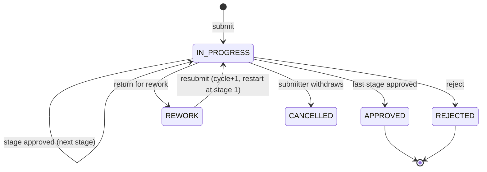
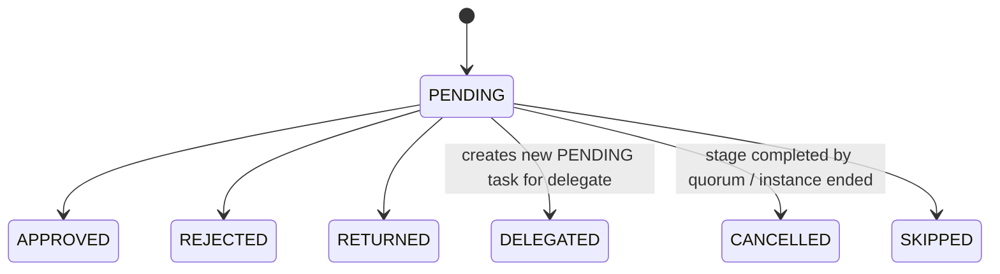
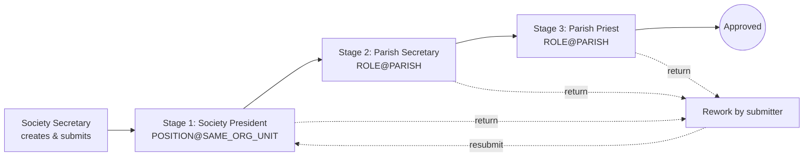

# 05 — Configurable Workflow & Approval Engine

## 1. Concepts

| Concept | Meaning |
|---|---|
| **Workflow definition** | Named, versioned approval process for an `entity_type`, with optional `conditions` (org unit type, category, amount range). |
| **Stage** | An ordered step. `mode = SEQUENTIAL` (one task at a time per assignee group) or `PARALLEL` (all assignees get tasks simultaneously, completed by `quorum` ALL / ANY / N). Can be `optional` (skipped when no assignee resolves). |
| **Assignee rule** | How reviewers are found **at the time the stage starts**: `ROLE@PARISH` (anyone with role parish-wide), `ROLE@SAME_ORG_UNIT` (role scoped to the entity's org unit), `POSITION@SAME_ORG_UNIT` (current office bearer), `POSITION@PARENT_ORG_UNIT`, `USER` (specific user). |
| **Instance** | One run of a definition for one entity; stores a **snapshot** of the definition. |
| **Task** | A unit of work for one user at one stage. |
| **Action** | Immutable history row: who, when, what, comment, previous/new status, stage. |
| **Handler** | Module-registered callbacks that change the business entity's status. |

## 2. Definition selection

```
candidates = active definitions where entity_type = X
filter: every condition key matches the entity context
  org_unit_type == ctx.org_unit_type
  category in ctx.categories
  min_amount <= ctx.amount <= max_amount
choose highest priority, then most conditions matched
none → 422 NO_WORKFLOW_CONFIGURED (or auto-approve if setting `workflow.auto_approve_unconfigured`)
```

## 3. State machines

### Instance



### Task



## 4. Engine algorithm

```
submit(entity_type, entity, ctx, user):
  ensure no active instance for entity
  defn = select_definition(entity_type, ctx)
  inst = Instance(snapshot=defn, status=IN_PROGRESS, cycle=1)
  log action SUBMIT
  start_stage(inst, first stage)
  handler.on_submitted(entity)

start_stage(inst, stage):
  users = resolve_assignees(stage.rules, ctx) − {submitter if setting forbids self-approval}
  apply active delegations (delegator → delegate)
  if users empty:
     if stage.optional: log SKIP; go to next stage
     else: escalate to fallback rule (Parish Administrator) and notify
  create task per user (due_at = now + sla_hours)
  notify assignees

act(task, action, comment, user):
  assert task.status == PENDING and task.assignee == user  (or admin override, audited)
  APPROVE  → task APPROVED; if quorum met: cancel remaining tasks; next stage or finish(APPROVED)
  REJECT   → task REJECTED; cancel others; finish(REJECTED)  → handler.on_rejected
  RETURN   → task RETURNED; cancel others; inst REWORK → handler.on_rework (entity editable)
  DELEGATE → task DELEGATED; new task for delegate (if stage.allow_delegation)
  log action with prev/new instance status, stage, comment

resubmit(inst, user): inst.cycle += 1; status IN_PROGRESS; start at first stage
finish(APPROVED) → handler.on_approved(entity)
```

All operations run inside one DB transaction; tasks are selected `FOR UPDATE` to prevent double approval in parallel stages.

## 5. SLA & escalation

Celery beat every 15 min per tenant: tasks `PENDING` with `due_at < now`:
1. send reminder (once per `sla_hours`),
2. if stage has `escalate_rules`: add task(s) for escalation assignees, mark `escalated=true`, log `ESCALATE`.

## 6. Handlers (per entity)

| Entity | on_submitted | on_approved | on_rejected | on_rework |
|---|---|---|---|---|
| Activity | status → IN_REVIEW | APPROVED | REJECTED | REWORK (editable) |
| Meeting minutes | IN_REVIEW | APPROVED (minutes locked) | REJECTED | REWORK |
| Fin transaction | SUBMITTED | APPROVED (counts in balances; `approved_by`) | REJECTED | REWORK |
| Fin period | UNDER_REVIEW | APPROVED → generate statement (job) → RELEASED when priest releases | OPEN | OPEN |
| Notice | IN_REVIEW | APPROVED → PUBLISHED at `publish_at` | REJECTED | REWORK |

## 7. Seeded example workflows

### Activity (Society)

Same definition with `conditions.org_unit_type = ANBIYAM` → Anbiyam President → Parish Secretary → Priest.

### Meeting minutes
Secretary submits → Stage 1 President (`POSITION@SAME_ORG_UNIT`) → Stage 2 Parish Priest.

### Financial transaction
- **Default:** Org Treasurer submits → Parish Treasurer → Parish Priest.
- **≥ ₹50,000** (`min_amount: 50000`, higher priority): Org Treasurer → Parish Treasurer → **Parish President & Parish Secretary (PARALLEL, ALL)** → Parish Priest.
- Parish-level entries (no org unit): Parish Treasurer submits → Parish Priest.

### Monthly statement (fin period)
Parish Treasurer closes month & submits → Parish Priest approves → statement v1 generated (PDF+XLSX, hash) → Priest releases → period `RELEASED` (locked).

### Notice
Preparer submits → Stage 1 **PARALLEL quorum ANY**: Parish Secretary or Parish President → Stage 2 Parish Priest → published at `publish_at`, expires at `expires_at`.

## 8. Configuration UI

- Workflow list per entity type; create new **version** (old instances keep their snapshot).
- Stage editor: drag to reorder, name, mode, quorum, optional, assignee rules builder (type → role/position/user → scope), SLA hours, escalation rule, delegation allowed.
- Condition builder: org unit type, category, amount range.
- Preview: "who would approve an Activity of *Youth Society*?" (resolves current assignees).

## 9. Approval UX

- **My Approvals inbox**: pending tasks, filters by module/age, bulk approve where permitted.
- **ApprovalTimeline** component on every workflowable record: stages, current pending approvers, actions with comments and timestamps, cycle separators for rework.
- Approve / Reject / Return buttons require a comment for reject/return.
