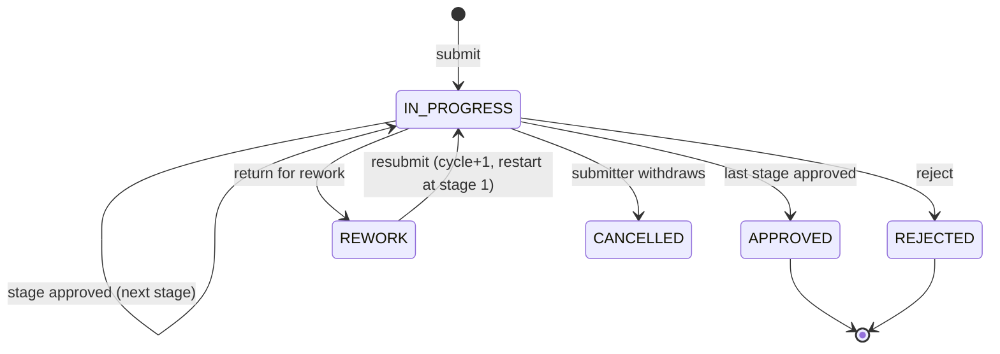
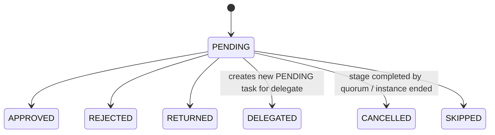
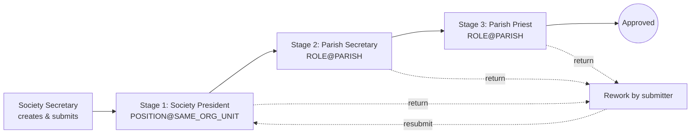

# 05 — Configurable Workflow & Approval Engine

## 1. Concepts

| Concept | Meaning |
|---|---|
| **Workflow definition** | Named, versioned approval process for an `entity_type`, with optional `conditions` (org unit type, category, amount range). |
| **Stage** | An ordered step. Every resolved assignee gets a task at the same time; the stage completes by `quorum` = `ANY` (first approval), `ALL`, or a number *N*. `kind` = `REVIEW` or `APPROVE` (wording of notifications). Can be `optional` (skipped when no assignee resolves). Stages themselves always run one after another. |
| **Assignee rule** | How reviewers are found **at the time the stage starts**: `ROLE@PARISH` (anyone with role parish-wide), `ROLE@SAME_ORG_UNIT` (role scoped to the entity's org unit), `POSITION@SAME_ORG_UNIT` (current office bearer), `POSITION@PARENT_ORG_UNIT`, `USER` (specific user). |
| **Instance** | One run of a definition for one entity; stores a **snapshot** of the definition. |
| **Task** | A unit of work for one user at one stage. |
| **Action** | Immutable history row: who, when, what, comment, previous/new status, stage. |
| **Handler** | Module-registered callbacks that change the business entity's status. |

## 2. Definition selection

```
candidates = active definitions where entity_type = X
filter: every condition key matches the entity context
  org_unit_type == ctx.org_unit_type
  category in ctx.categories
  min_amount <= ctx.amount <= max_amount
choose highest priority, then most conditions matched
none → 422 NO_WORKFLOW_CONFIGURED (or auto-approve if setting `workflow.auto_approve_unconfigured`)
```

## 3. State machines

### Instance



### Task



## 4. Engine algorithm

```
submit(entity_type, entity, ctx, user):
  ensure no active instance for entity
  defn = select_definition(entity_type, ctx)
  inst = Instance(snapshot=defn, status=IN_PROGRESS, cycle=1)
  log action SUBMIT
  start_stage(inst, first stage)
  handler.on_submitted(entity)

start_stage(inst, stage):
  users = resolve_assignees(stage.rules, ctx) − {submitter if setting forbids self-approval}
  apply active delegations (delegator → delegate)
  if users empty:
     if stage.optional: log SKIP; go to next stage
     else: escalate to fallback rule (Parish Administrator) and notify
  create task per user (due_at = now + sla_hours)
  notify assignees

act(task, action, comment, user):
  assert task.status == PENDING and task.assignee == user  (or admin override, audited)
  APPROVE  → task APPROVED; if quorum met: cancel remaining tasks; next stage or finish(APPROVED)
  REJECT   → task REJECTED; cancel others; finish(REJECTED)  → handler.on_rejected
  RETURN   → task RETURNED; cancel others; inst REWORK → handler.on_rework (entity editable)
  DELEGATE → task DELEGATED; new task for delegate (if stage.allow_delegation)
  log action with prev/new instance status, stage, comment

resubmit(inst, user): inst.cycle += 1; status IN_PROGRESS; start at first stage
finish(APPROVED) → handler.on_approved(entity)
```

All operations run inside one DB transaction; tasks are selected `FOR UPDATE` to prevent double approval in parallel stages.

## 5. SLA & escalation

Celery beat every 15 min per tenant: tasks `PENDING` with `due_at < now`:
1. send reminder (once per `sla_hours`),
2. if stage has `escalate_rules`: add task(s) for escalation assignees, mark `escalated=true`, log `ESCALATE`.

## 6. Handlers (per entity)

| Entity | on_submitted | on_approved | on_rejected | on_rework |
|---|---|---|---|---|
| Activity | status → IN_REVIEW | APPROVED | REJECTED | REWORK (editable) |
| Meeting minutes | IN_REVIEW | APPROVED (minutes locked) | REJECTED | REWORK |
| Fin transaction | SUBMITTED | APPROVED (counts in balances; `approved_by`) | REJECTED | REWORK |
| Fin period | UNDER_REVIEW | APPROVED → generate statement (job) → RELEASED when priest releases | OPEN | OPEN |
| Notice | IN_REVIEW | APPROVED → PUBLISHED at `publish_at` | REJECTED | REWORK |

## 7. Seeded example workflows

### Activity (Society)

Same definition with `conditions.org_unit_type = ANBIYAM` → Anbiyam President → Parish Secretary → Priest.

### Meeting minutes
Secretary submits → Stage 1 President (`POSITION@SAME_ORG_UNIT`) → Stage 2 Parish Priest.

### Financial transaction
- **Default:** Org Treasurer submits → Parish Treasurer → Parish Priest.
- **≥ ₹50,000** (`min_amount: 50000`, higher priority): Org Treasurer → Parish Treasurer → **Parish President & Parish Secretary (PARALLEL, ALL)** → Parish Priest.
- Parish-level entries (no org unit): Parish Treasurer submits → Parish Priest.

### Monthly statement (fin period)
Parish Treasurer closes month & submits → Parish Priest approves → statement v1 generated (PDF+XLSX, hash) → Priest releases → period `RELEASED` (locked).

### Notice
Preparer submits → Stage 1 **PARALLEL quorum ANY**: Parish Secretary or Parish President → Stage 2 Parish Priest → published at `publish_at`, expires at `expires_at`.

## 8. Configuration UI

- Workflow list per entity type; create new **version** (old instances keep their snapshot).
- Stage editor: drag to reorder, name, mode, quorum, optional, assignee rules builder (type → role/position/user → scope), SLA hours, escalation rule, delegation allowed.
- Condition builder: org unit type, category, amount range.
- Preview: "who would approve an Activity of *Youth Society*?" (resolves current assignees).

## 9. Approval UX

- **My Approvals inbox**: pending tasks, filters by module/age, bulk approve where permitted.
- **ApprovalTimeline** component on every workflowable record: stages, current pending approvers, actions with comments and timestamps, cycle separators for rework.
- Approve / Reject / Return buttons require a comment for reject/return.

## 10. Implementation notes (T10)

What was built, and where it differs from the sketch above:

- **Quorum instead of modes.** Every resolved assignee receives a task at once. `quorum` (`ANY` / `ALL` / *N*) decides when the stage is complete. Remaining tasks become `CANCELLED` ("not needed").
- **Assignee rules** are stored as `{type, role | position | user_id, scope}`:
  - `type` is `ROLE`, `POSITION` or `USER`.
  - `scope` is `PARISH`, `SAME_ORG_UNIT` or `PARENT_ORG_UNIT`. Positions require an organisation scope.
  - Role holders of a *parent* organisation also qualify for `SAME_ORG_UNIT`, because roles flow down the tree as in RBAC.
- **Resolving a stage** happens in this order:
  1. Apply the rules.
  2. Remove the submitter, unless the setting `workflow.allow_self_approval` is on.
  3. If nobody is left: an **optional** stage is skipped (logged `SKIP`); a required stage falls back to the Parish Administrators (`FALLBACK`). With no administrator either, submission fails with `NO_APPROVER`.
  4. Apply active delegations. A delegation never routes a decision to the submitter.
- **Delegation** comes in two forms:
  - *Standing*: "while I am away", with dates and an optional list of record types. It affects tasks created while it is active.
  - *Per task*: the `DELEGATE` action hands one task to someone else, unless the stage sets `allow_delegation: false`.
- **Escalation.** The SLA sweep runs every 15 minutes via Celery beat (`ps-admin workflow-sla` runs it by hand). For each overdue task it:
  - reminds the assignee once per SLA period (`workflow.reminder`);
  - once per stage, adds tasks for the `escalate_to` people. Escalation tasks are extra: one approval from them completes the stage, but they never count towards `ALL`.
- **Administrator override.** Holders of `workflow.manage` may decide any pending task. The action records `actor` and `on_behalf_of`, and an `OVERRIDE` audit entry is written.
- **Versions.** Editing (`PUT /workflow/definitions/{id}`) always creates version *n+1* with the same `code`.
  - Instances keep a snapshot of the version they started with, including on resubmission.
  - Only the latest version can be edited or switched on/off.
- **Business modules** integrate in four steps:
  1. `register_handler(entity_type, WorkflowHandler(on_submitted=…, on_approved=…, on_rejected=…, on_rework=…, on_withdrawn=…))`.
  2. Call `service.submit(...)`, `service.resubmit(...)` and `service.withdraw(...)` from their own endpoints.
  3. Render `ApprovalTimeline` with `useEntityApprovals(type, id)`.
  4. Callbacks run in the engine's transaction.

  The entity types (`ACTIVITY`, `MEETING_MINUTES`, `FIN_TRANSACTION`, `FIN_PERIOD`, `NOTICE`) are fixed in `workflow/registry.py`.

### API (`/api/v1/workflow`)

| Endpoint | Who |
|---|---|
| `GET entity-types`, `GET definitions[?entity_type|code]`, `GET definitions/{id}`, `POST preview` | `workflow.view` |
| `POST definitions`, `PUT definitions/{id}` (new version), `POST definitions/{id}/activate|deactivate` | `workflow.manage` |
| `GET tasks?state=PENDING|DONE&entity_type&overdue`, `GET tasks/summary` | own tasks |
| `POST tasks/{id}/act` `{action: APPROVE|REJECT|RETURN|DELEGATE, comment, delegate_user_id}` | assignee, or `workflow.manage` (override) |
| `POST tasks/bulk-approve` `{task_ids}` | own tasks; each decided independently |
| `GET instances[?mine=false]`, `GET instances/{id}`, `GET entities/{type}/{id}` | submitter, (former) assignees, `workflow.view`, or `<module>.view` for the record's organisation |
| `POST instances/{id}/withdraw`, `POST instances/{id}/resubmit` | submitter |
| `GET/POST delegations`, `POST delegations/{id}/end` | own; others' with `workflow.manage` |

Error codes: `NO_WORKFLOW_CONFIGURED`, `NO_APPROVER`, `ALREADY_SUBMITTED`, `COMMENT_REQUIRED`, `TASK_NOT_PENDING`, `NOT_ASSIGNEE`, `NOT_SUBMITTER`, `DELEGATION_NOT_ALLOWED`, `INVALID_DELEGATE`, `SELF_APPROVAL`, `NOT_LATEST_VERSION`.

### Screens

- **Approvals → My Approvals:**
  - Shown to every signed-in user, because tasks can reach anyone through user rules, positions or delegation.
  - The menu badge shows the pending count and turns red when something is overdue.
  - Tabs: Waiting / Decided. Filter by type and overdue. Bulk approve.
  - A **Delegations** dialog.
- **Approvals → Submitted by Me:** progress and current approvers.
- **`/approvals/{id}`:**
  - the decision panel: Approve / Return / Reject / Delegate. Return and Reject need a comment.
  - for administrators, *Decide on behalf of a reviewer*.
  - withdraw or resubmit for the submitter.
  - the **ApprovalTimeline**: stages, decisions, comments, and history with rework cycles.
- **Administration → Workflows:** definitions grouped by record type, with an on/off switch. The designer has:
  - general settings and conditions;
  - a stage editor (reorder, quorum, optional, SLA, delegation, assignee and escalation rule builders);
  - a live **Who would approve?** preview of unsaved changes;
  - version history.

### Upgrading

Tenant migration `0008` creates the workflow tables, and the seeder adds the default workflows. Run `ps-admin migrate-tenants`. In Docker, the dev worker now runs with `-B` so the SLA sweep is scheduled.
